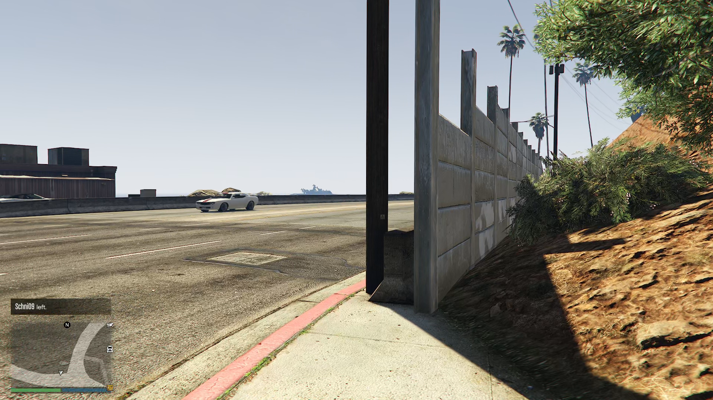

# MCT 밖의 입력 오작동 (#270)

2026-10-13 KST 약 22:15:54~22:20:57의 Steam 게임 녹화를 재생했다. 원본은 3초 영상 조각이며 파일 수정 시각으로 구간을 맞췄으므로 화면 시각에는 약 3초 오차가 있다. 전체 구간의 4배속 재생에서 야외 도로에 서 있는 동안 카메라가 여러 번 회전하고 3인칭에서 1인칭으로 바뀌는 것을 확인했다.

약 22:19:34의 원본 1920×1080 프레임이다. 당시 로그에는 22:19:35 AFK 포커스 복구 뒤 22:19:56 MCT 정리 실패가 남았다. 이 프레임에서 원래 AFK 진입 후보의 템플릿·탐색 영역·색상 허용값을 대조하니 `dj_solomun`만 일치했다. 기본 밝기에서 첫 일치는 `(864, 238)`이며 후보는 309곳이었다. 해당 템플릿은 흰 글자와 투명 비교 제외색으로 구성되어 하늘을 DJ 이름으로 오인했다. 실제 게임의 판독 반환값을 직접 계측한 결과는 아니며, 저장 영상 픽셀과 코드 조건의 대조 결과다.

수정 전 기준은 `5e8e95f0ad3c779dea371c2724757d98328aa4f6`이다. `EarnTaskMCTBegin`의 위치 미확인 카메라 탐색과 보스 메뉴 호출을 삭제하고, AFK 정리 진입 후보에서 단독 DJ 이름 판정을 제거했다. 확인된 MCT 진입 뒤의 복귀·CEO 해제와 기존 DJ 확인창 정리는 유지한다.
